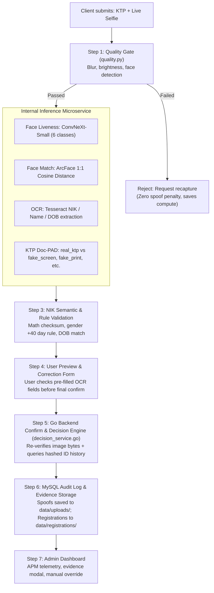

# Indonesian e-KYC & Liveness Detection — Project Summary

## 1. Scope & Positioning

- **Core System**: An end-to-end electronic KYC (e-KYC) and anti-spoofing verification platform designed for a banking onboarding registration flow.
- **Components**:
  1. **Face Liveness Detection (PAD)**: Single-selfie 6-class classification catching physical and digital presentation attacks.
  2. **1:1 Facial Verification**: ArcFace cosine-distance face matching between the KTP portrait and the live selfie.
  3. **ID Field OCR & Human Review**: Tesseract OCR extracting Indonesian KTP fields (NIK, Name, DOB) with a 2-step preview and user correction loop.
  4. **Pre-Inference Quality Gating**: Fast OpenCV filters for blur, brightness, and face size to prevent wasted compute and false rejections.
  5. **KTP Forgery & Spoof Detection (Doc-PAD)**: Document presentation attack detection (catching screens, prints, altered text/photos) paired with deterministic NIK mathematical checks.
  6. **Graduated Decision Engine**: History-aware risk scoring tied to SHA-256 hashed IDs rather than instant hard blocks.
  7. **Admin Audit & APM Console**: Protected portal with telemetry charts, evidence viewer, and manual decision overrides.

---

## 2. Models & Detection Engines

### A. Face Liveness Classifier (`inference/app/model_loader.py`, `preprocess.py`)
- **Architecture**: `convnext_small.fb_in22k_ft_in1k` loaded via `timm` with a 6-class linear head.
- **Weights**: `inference/model/model_fold_0.pth` (~189 MB, PyTorch `state_dict`).
- **Classes**: `fake_mannequin`, `fake_mask`, `fake_printed`, `fake_screen`, `fake_unknown`, `realperson`.
- **Preprocessing**: 256×256 bilinear resize, BGR→RGB, ImageNet normalization, single-image tensor batch.
- **Inference**: CPU-only forward pass, softmax probabilities, `is_live = (predicted_class == "realperson")`.

### B. Facial Matcher (`inference/app/face_match.py`)
- **Engine**: DeepFace running ArcFace cosine-similarity comparison between cropped KTP portrait and selfie.
- **Weights**: Pre-baked into Docker image during build (`/root/.deepface`) to eliminate container startup download delays.

### C. ID OCR Engine (`inference/app/ocr.py`)
- **Engine**: Tesseract OCR (`pytesseract`, `--oem 1 --psm 6`, languages `ind+eng`).
- **Preprocessing**: Grayscale, bilateral filter denoising, and CLAHE local contrast enhancement (no hard binarization to let LSTM adapt).
- **Post-processing**: Regex matching scoped to field labels (`NIK`, `Nama`, `Tgl Lahir`) with digit/letter confusion corrections.

### D. Image Quality Pre-Filter (inference/app/quality.py)
- **Blur**: Laplacian variance threshold ($< 100 \rightarrow$ 	oo_blurry).
- **Brightness**: Grayscale mean luminance check ( \le \text{mean} \le 215$).
- **Face Area**: Haar Cascade detector checking face presence and frame area ratio ($\ge 0.005$).
- **Master Toggle (ENABLE_QUALITY_GATING)**: All validation thresholds and algorithms remain fully preserved in code, but rejection is guarded behind ENABLE_QUALITY_GATING (deactivated by default to allow direct stress-testing of edge cases without early exits).

### E. KTP Forgery & Spoof Detection (Doc-PAD & Semantics)
- **Trained Deep Learning Model**: est_convnext_small_ktp_pad.pth (~189 MB) fine-tuned on balanced, group-stratified zero-leakage partitions (2,088 train, 540 test). Augmented with 98 targeted Full HD webcam captures (42 
eal_ktp, 56 ake_print).
- **Model Taxonomy (5 Classes)**:
  - 
eal_ktp: Authentic, genuine physical KTP photographed by camera.
  - ake_screen: KTP presented on an LCD/OLED screen (Moiré pattern, subpixel grid).
  - ake_print: Paper or cardstock printout/cutout (halftone dots, flat non-reflective texture).
  - ake_template: Synthetic KTP generator output (e.g. cloverx-id/indonesian-id-card-dummy).
  - other: Non-KTP hard negative documents (ATM cards, SIM cards, driver licenses, receipts).
- **Dual-Mode Inference Engine (inference/app/ktp_forgery.py)**:
  - Automatically loads est_convnext_small_ktp_pad.pth from model/ or inference/model/.
  - Heuristic fallback engine with realistic probability distribution when weights are absent.
- **Deterministic Checksum & Semantic Validation**:
  - Validates NIK 16-digit structure, official Kemendagri province/regency codes.
  - Validates female birth day offset formula: $\text{Date} = \text{Birth Day} + 40$.
  - Validates cross-field agreement between extracted OCR birth date and NIK birth date digits.

---

## 3. End-to-End Pipeline



---

## 4. Architecture

| Component | Choice | Notes |
|---|---|---|
| **Frontend** | React (Create React App) | Runs at `:3000` (dev); served as static build by native Nginx (prod) |
| **Reverse Proxy** | Nginx (native on VM) | Public entry point routing traffic to frontend and Go backend |
| **Backend** | Go + Gin (Dockerized) | Runs at `:8080`; handles business logic, DB access, and APM logging |
| **Inference Service** | Python + FastAPI (Dockerized) | **Internal-only**; no host port mapping; reachable only via Docker network |
| **Database** | MySQL 8.0 (Dockerized) | Stores `spoof_attempts`, `registrations`, and `api_requests` |
| **Database GUI** | phpMyAdmin (Dockerized) | Runs at `:8081` for administrative inspection |
| **Evidence Storage** | Local filesystem (Docker volume) | `./data` mounted into backend; date-partitioned subfolders |

---

## 5. Decision Logic

### A. Liveness-Only Flow (`decision_service.go`)
Tied to a SHA-256 hash of the ID number, with memory of past attempts:

| Current Result | Prior Spoofs (Same Hashed ID) | Final Decision |
|---|---|---|
| Genuine (`realperson`) | $< 3$ | `continue_registration` |
| Genuine (`realperson`) | $\ge 3$ | `manual_review` (clean now, but suspicious history) |
| Spoof (`fake_*`) | $< 3$ | `manual_review` |
| Spoof (`fake_*`) | $\ge 3$ | `blocked_flagged` |
| Poor Quality | Any | `rejected_poor_quality` (does not count toward block history) |

### B. eKYC Registration Flow (`ekyc_controller.go`)
Evaluated in strict waterfall order:
1. Quality failed $\rightarrow$ `rejected_poor_quality`
2. `!is_live` $\rightarrow$ `rejected_spoof`
3. `ktp_spoof` detected $\rightarrow$ `rejected_ktp_forgery`
4. `!face_match_verified` $\rightarrow$ `rejected_face_mismatch`
5. NIK does not match `^\d{16}$` or fails checksum $\rightarrow$ `manual_review`
6. Otherwise $\rightarrow$ `approved`

*Admins can manually override any registration decision via `PATCH /admin/registrations/:id/decision` to `approved` or `rejected_manual`.*

---

## 6. Directory Structure

```
ekyc/
├── backend/                        # Go + Gin REST API
│   ├── cmd/main.go                 # Server entrypoint & route wiring
│   ├── internal/app/
│   │   ├── controllers/            # HTTP handlers (liveness, ekyc, apm)
│   │   ├── dtos/                   # Request/response transfer objects
│   │   ├── middleware/             # APM latency & access middleware
│   │   ├── models/                 # Database entities (MySQL)
│   │   ├── repositories/           # DB queries (database/sql)
│   │   ├── routes/                 # Gin route group definitions
│   │   ├── services/               # Inference client & decision logic
│   │   └── utils/                  # SHA-256 hash & image storage
│   ├── internal/config/            # Config parser & DB connection pool
│   └── Dockerfile
├── inference/                      # Python FastAPI ML Microservice
│   ├── app/
│   │   ├── main.py                 # FastAPI routes (/health, /infer, /ekyc-check)
│   │   ├── model_loader.py         # ConvNeXt model loader
│   │   ├── preprocess.py           # Image preprocessing pipeline
│   │   ├── quality.py              # Blur, brightness, face detection checks
│   │   ├── ocr.py                  # Tesseract KTP parser & heuristics
│   │   ├── face_match.py           # ArcFace face verification
│   │   └── schemas.py              # Pydantic schema validation
│   ├── model/
│   │   └── model_fold_0.pth        # Trained weights for ConvNeXt PAD
│   ├── requirements.txt
│   └── Dockerfile
├── frontend/                       # React Single Page App
│   ├── src/
│   │   ├── components/             # CameraCapture, Charts, UI tiles
│   │   ├── pages/
│   │   │   ├── RegistrationPage.jsx# Mode 1: Standalone selfie liveness check
│   │   │   ├── EkycPage.jsx        # Mode 2: Legacy 2-step eKYC onboarding flow
│   │   │   ├── CompletePipelinePage.jsx # Mode 3: Complete e-KYC pipeline (Doc-PAD + OCR + Liveness + Match)
│   │   │   ├── KtpForgeryPage.jsx  # Mode 4: Standalone Doc-PAD analysis
│   │   │   └── AdminDashboard.jsx  # APM metrics & registration audit
│   │   └── services/api.js         # Backend API client
│   └── package.json
├── notebooks/                      # Dedicated Jupyter research workspace
│   ├── 01_explore_ktp_dataset.ipynb# Streaming KTP inspection & NIK validation tests
│   ├── 02_download_ktp_flat.ipynb  # Interactive partition downloader & row verification
│   ├── 03_data_augmentation.ipynb  # Deterministic 35x batch data augmentation pipeline
│   ├── 04_train_test_split.ipynb   # Group-stratified train/test split generator
│   ├── 05_targeted_augmentation.ipynb # Targeted 6x webcam augmentation & ID renaming
│   └── archive_final_hmster_kaggleversion.ipynb # Relocated original ConvNeXt training notebook
├── datasets/                       # Local dataset store (strictly git-ignored)
│   ├── raw/cloverx_ktp/flat/       # Downloaded Parquet partitions (12 files, ~11.8 GB)
│   ├── processed/                  # Base collected & dumped images
│   │   ├── fake_template/          # 2,000+ raw PNGs dumped for template attack training
│   │   ├── real_ktp/               # Target for authentic physical card captures
│   │   ├── fake_screen/            # Target for photographed screen replays
│   │   ├── fake_print/             # Target for photographed printouts
│   │   └── other/                  # Non-KTP hard negatives (SIM, credit cards, receipts)
│   └── augmented/                  # 35x expanded training variations per class
├── scripts/                        # Reusable CLI tooling
│   ├── download_ktp_flat.py        # Direct HTTP streaming downloader with resume support
│   └── export_parquet_images.py    # High-speed raw PNG dumper from Parquet
├── data/                           # Mounted persistent storage
│   ├── uploads/                    # Flagged spoof selfies (date-partitioned)
│   └── registrations/              # KYC ID cards & selfies (date-partitioned)
├── docs/                           # Documentation & specifications
├── AGENTS.md                       # Core project rules & conventions
├── docker-compose.yml              # Container orchestration
└── readme.md                       # Comprehensive operational guide
```

---

## 7. Status & Roadmap

- [x] ConvNeXt-Small 6-Class Face Liveness model integration (model_fold_0.pth).
- [x] DeepFace ArcFace face verification with pre-baked weights.
- [x] Tesseract KTP OCR with Indonesian heuristics.
- [x] Pre-inference quality checks (blur, brightness, face size, with document-mode bypass for face detection).
- [x] 2-step preview and edit registration flow.
- [x] Graduated decision service and hashed ID tracking.
- [x] Admin audit dashboard with APM telemetry and image modals.
- [x] Docker multi-container networking (internal-only inference).
- [x] **KTP Dataset Acquisition & Zero-Leakage Split**: Grouped zero-source-leakage partitioning (2,088 train, 540 test across 5 balanced classes).
- [x] **KTP Doc-PAD Model Training**: Trained ConvNeXt-Small 5-class model on Kaggle (est_convnext_small_ktp_pad.pth, 188.8 MB, 100% test accuracy on Epoch 5).
- [x] **4 Operational UI Modes**:
  - Mode 1: Face Liveness PAD (/)
  - Mode 2: Advance eKYC (OCR + Selfie Liveness + ArcFace) (/ekyc)
  - Mode 3: Complete 4-Pillar Pipeline (/pipeline)
  - Mode 4: Standalone Doc-PAD Forgery Testbed (/ktp-forgery)
- [ ] **Next Priorities (Upcoming Session)**:
  - [ ] **UI Card Design Alignment**: Redesign Mode 3 (CompletePipelinePage) and Mode 4 (KtpForgeryPage) input interfaces to use standard white card containers matching Mode 2 (EkycPage) instead of plain backgrounds.
  - [ ] **Comprehensive Scenario Testing**: Test varied attack scenarios (screen glare, high/low resolution, paper printouts, cutouts, tampered photos, edge-case cards).
  - [ ] **Rejection & Escalation Logic Audit**: Review and refine auto-rejection rules and decision engine triggers across Doc-PAD, NIK validity, and quality gates.

---

## 8. Out of Scope

- Live government database queries (Dukcapil API integration requires official institutional licensing).
- Video or multi-frame challenge-response liveness (all models operate on single 2D images).
- Physical NFC chip reading (e-KTP RFID chips require specialized hardware / native mobile NFC SDKs).
- Full enterprise compliance machinery (automated data retention policies, formal audit exports).
