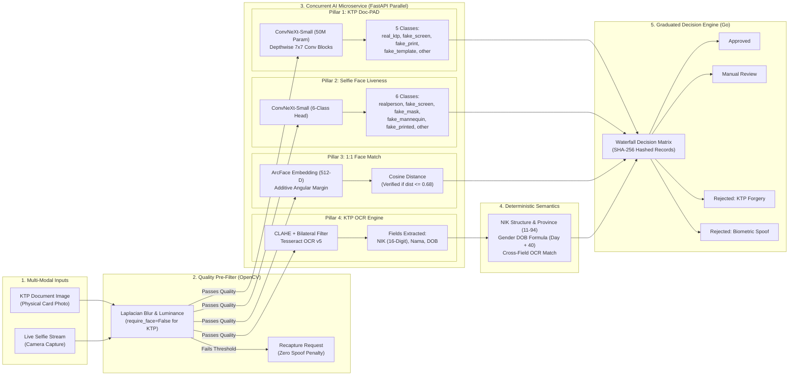

# Master Prompt: End-to-End Pipeline & Architecture Diagram

Dokumen ini berisi kumpulan prompt dan kode diagram arsitektur pipeline lengkap aplikasi **Indonesian e-KYC & Anti-Spoofing Service** yang siap di-copy-paste ke AI pembuat diagram (seperti ChatGPT/DALL-E, Claude, Eraser.io, Napkin.ai, Whimsical, Midjourney) maupun visualizer Mermaid.

---

## 1. Master Prompt Bahasa Inggris (Rekomendasi Utama untuk AI Diagram Generator)

> *Gunakan prompt ini di ChatGPT (GPT-4o), Claude 3.5 Sonnet, Eraser.io AI, atau Napkin.ai untuk menghasilkan diagram bergaya paper ilmiah (CVPR/ECCV/IEEE).*

```text
Create a comprehensive, publication-quality academic architecture diagram for an "End-to-End Indonesian e-KYC & Anti-Spoofing Verification Pipeline". The style should look like a modern computer vision paper architecture diagram (similar to CVPR/ECCV pipeline figures) with clean modular boxes, colored rounded stages, tensor dimensions, and directional flow arrows.

The diagram must show the following 6 sequential and parallel stages clearly:

STAGE 1: DUAL INPUT INGESTION
- Box 1: "KTP Card Capture" (Indonesian National Identity Card image, RGB)
- Box 2: "Live User Selfie" (Webcam facial capture, RGB)

STAGE 2: PRE-INFERENCE QUALITY GATING (OpenCV Heuristics)
- Directed to a shared module: "Heuristic Image Quality Gate"
- Sub-checks indicated inside:
  * Laplacian Variance Blur Score (Threshold >= 100.0)
  * Mean Luminance Brightness (Range 40 - 215)
  * Haar Cascade Face Size Check (Bypassed for KTP: require_face=False)
- Branch: "Failed" -> Red Pill: "Instant Recapture Request (Zero Spoof Penalty)"
- Branch: "Passed" -> Advances to Stage 3

STAGE 3: PARALLEL MULTI-MODAL AI MICROSERVICE (FastAPI / PyTorch - asyncio.gather)
Show 4 concurrent branches running in parallel:
1. Branch A: "KTP Doc-PAD (Presentation Attack Detection)"
   - Architecture: ConvNeXt-Small (50M parameters, pre-trained ImageNet-22k)
   - Input: 256x256x3 Tensor -> 4-Stage ConvNeXt Depthwise Blocks (7x7 Kernels, LayerNorm, GELU) -> Global Avg Pool -> 5-Class Softmax Head
   - Output: 5 Classes (real_ktp, fake_screen, fake_print, fake_template, other)
2. Branch B: "Face Liveness PAD"
   - Architecture: ConvNeXt-Small (6-Class Linear Head)
   - Output: 6 Classes (realperson, fake_screen, fake_printed, fake_mask, fake_mannequin, fake_unknown)
3. Branch C: "1:1 Biometric Verification"
   - Architecture: DeepFace ArcFace (512-dim Angular Margin Embeddings)
   - Compares: Cropped KTP Portrait vs Live Selfie
   - Output: Cosine Distance Metric (Verified if dist <= 0.68)
4. Branch D: "OCR & Document Extraction"
   - Preprocessing: Grayscale -> Bilateral Filter -> CLAHE
   - Engine: Tesseract OCR v5 (Indonesian + English)
   - Output: Extracted Fields (16-Digit NIK, Name, Date of Birth)

STAGE 4: DETERMINISTIC VALIDATION & CROSS-CHECK
- Module: "Deterministic Rule & Checksum Engine"
  * NIK 16-Digit Structure & Province Code Verification (Kemendagri 11-94)
  * Female Birthday Checksum Formula (Day + 40 Offset)
  * OCR vs NIK Date Consistency Validation

STAGE 5: GRADUATED DECISION ENGINE (Golang Backend)
- Module: "Graduated Waterfall Risk Evaluator"
- Inputs combined: Doc-PAD + Face Liveness + ArcFace Distance + NIK Validation + SHA-256 ID History
- Outputs 4 distinct decision badges:
  * Green: "Approved" (All Biometric & Doc Signals Valid)
  * Yellow: "Manual Review" (OCR Mismatch / NIK Checksum Ambiguity)
  * Red: "Rejected: KTP Forgery" (fake_screen / fake_print / fake_template)
  * Red: "Rejected: Spoof" (fake_mask / fake_screen / fake_mannequin)

STAGE 6: EVIDENCE STORAGE & APM AUDIT
- Data Persist: SHA-256 Hashed ID + MySQL Audit Records
- Admin Console: APM Microservice Latency Telemetry + Auth-Gated Evidence Viewer

Visual Styling:
- Use clear color coding: Blue for Inputs, Teal/Green for Neural Networks, Orange for Processing/Features, Purple for Decision Logic, Red/Green for Final Outcomes.
- Use clean arrows showing tensor and data flow between stages.
- Minimalist, high-tech, readable layout on clean background.
```

---

## 2. Master Prompt Bahasa Indonesia

> *Gunakan prompt ini jika Anda menggunakan platform AI generator lokal atau menginginkan teks label dalam Bahasa Indonesia.*

```text
Buat diagram arsitektur pipeline kecerdasan buatan (AI) yang profesional, detail, dan ilmiah bergaya paper CVPR/IEEE untuk sistem "Pipeline End-to-End e-KYC & Deteksi Pemalsuan KTP/Wajah Terintegrasi".

Tampilkan alur data secara visual dari kiri ke kanan (atau atas ke bawah) dengan 6 tahap utama berikut:

1. INPUT GANDA (MULTI-MODAL INGESTION):
   - Foto KTP Indonesia (file upload / webcam)
   - Foto Selfie Pengguna Langsung (live capture)

2. FILTER KUALITAS AWAL (OPENCV QUALITY GATE):
   - Uji Blur (Laplacian Variance >= 100.0)
   - Uji Kecerahan (Mean Luminance 40 - 215)
   - Deteksi Wajah Haar Cascade (Khusus Selfie wajib terdeteksi; untuk KTP di-bypass: require_face=False)
   - Jika Gagal: Permintaan foto ulang (Recapture, tanpa penalti penipuan)
   - Jika Lolos: Masuk ke tahap inferensi AI paralel

3. MICROSERVICE AI PARALEL (PYTORCH FASTAPI):
   Tampilkan 4 cabang yang diproses bersamaan (concurrent):
   a. Doc-PAD KTP: ConvNeXt-Small (50M parameter, input 256x256x3) -> Klasifikasi 5 Kelas (real_ktp, fake_screen, fake_print, fake_template, other).
   b. Face Liveness Selfie: ConvNeXt-Small -> Klasifikasi 6 Kelas (realperson, fake_screen, fake_printed, fake_mask, fake_mannequin, fake_unknown).
   c. Biometric Face Match: DeepFace ArcFace (512-D Embedding) -> Cosine Distance (Valid jika <= 0.68).
   d. KTP OCR: Preprocessing CLAHE + Bilateral Filter -> Tesseract OCR v5 -> Ekstraksi NIK, Nama, Tanggal Lahir.

4. VALIDASI DETERMINISTIK & CHECKSUM NIK:
   - Validasi struktur 16 digit NIK & Kode Wilayah Provinsi (11-94).
   - Validasi rumus tanggal lahir gender wanita (Hari lahir + 40).
   - Cross-check kesesuaian tanggal lahir teks KTP vs angka di dalam NIK.

5. DECISION ENGINE BERLAPIS (GRADUATED ENGINE - GOLANG):
   - Evaluasi waterfall otomatis:
     * Approved (Semua pilar valid)
     * Manual Review (Keraguan pembacaan OCR / anomali NIK)
     * Rejected KTP Forgery (Terdeteksi manipulasi/spoofing KTP)
     * Rejected Biometric Spoof (Terdeteksi manipulasi/spoofing wajah)

6. PENYIMPANAN BUKTI & APM DASHBOARD:
   - NIK di-hash menggunakan SHA-256 (tanpa plaintext).
   - Database MySQL menyimpan log registrasi & rekaman latensi API.
   - Admin Dashboard dengan autentikasi Bearer Token untuk audit kepatuhan.

Gaya Visual:
- Gunakan skema warna modern: Biru muda untuk input, Hijau/Toska untuk Deep Learning, Oranye untuk pemrosesan fitur, Ungu untuk Decision Engine, Merah/Hijau untuk hasil keputusan.
- Kotak modular rounded, label teks tajam dan mudah dibaca, panah alur tensor yang presisi.
```

---

## 3. Kode Diagram Mermaid (Langsung Render di Notion, GitHub, atau mermaid.live)

> *Salin kode di bawah ini dan tempel di website [mermaid.live](https://mermaid.live) untuk langsung melihat diagram interaktifnya atau mengekspornya menjadi PNG/SVG resolusi tinggi untuk Canva.*



---

## 4. Parameter & Spesifikasi Teknis Cepat (Quick Cheatsheet)

| Modul / Komponen | Arsitektur / Algoritma | Parameter / Detail Kunci |
|---|---|---|
| **Quality Gating** | OpenCV Grayscale & Laplacian | $\text{Var}(\Delta I) \ge 100$, Luminance $40-215$, Canonical resize $256 \times 256$ |
| **KTP Doc-PAD** | `convnext_small.fb_in22k_ft_in1k` | 50M parameter, 5 kelas output, ImageNet-22k pretrained |
| **Selfie Liveness** | `convnext_small.fb_in22k_ft_in1k` | 50M parameter, 6 kelas output, binary `is_live` rule |
| **Biometric Matcher** | DeepFace ArcFace | 512-dim embedding, Cosine metric, threshold $0.68$ |
| **OCR Field Parser** | Tesseract v5 + CLAHE | Bilateral filter, regex multi-field, character substitution |
| **Semantic Validator** | Deterministic Formula | Kemendagri province code (11-94), Female date $+40$ rule |
| **Backend & Privacy** | Go + Gin, MySQL | SHA-256 ID hashing, Auth-gated admin routes, APM APM latency tracker |

