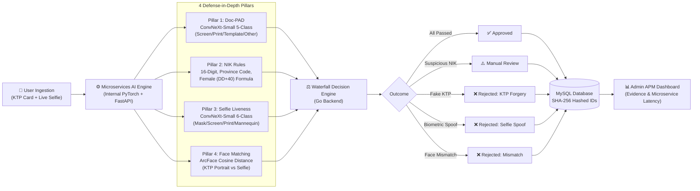

# 🛡️ Indonesian e-KYC & Anti-Spoofing Service

An end-to-end, multi-pillar electronic Know-Your-Customer (e-KYC) and anti-fraud onboarding platform designed for banking registration flows.

The platform provides a defense-in-depth verification pipeline combining **Deep Learning Document PAD (KTP Forgery Detection)**, **Deterministic NIK Validation**, **Single-Frame Face Liveness PAD**, **1:1 ArcFace Biometric Verification**, and a **Graduated Risk Decision Engine**.

---

## 📌 Architecture & Verification Pipeline



---

## 🚀 Key Features

| Capability | Technology | Description |
|---|---|---|
| **KTP Forgery Detection (Doc-PAD)** | ConvNeXt-Small (`timm`) | 5-class classifier detecting physical screen replays, printed cardstock, synthetic dummy templates, and non-KTP documents. |
| **Deterministic Indonesian NIK Engine** | Custom Regex & Math Checksum | Validates 16-digit structure, Kemendagri province codes (11–94), female birth date offset ($DD + 40$), and OCR cross-field consistency. |
| **Selfie Face Liveness (Biometric PAD)** | ConvNeXt-Small (Fine-tuned) | 6-class presentation attack detector: `realperson`, `fake_printed`, `fake_mask`, `fake_mannequin`, `fake_screen`, `fake_unknown`. |
| **1:1 ArcFace Biometric Matching** | DeepFace (ArcFace 512-D) | Computes normalized cosine distance between the cropped KTP portrait and webcam selfie (threshold $\le 0.68$). |
| **ID Field Extraction & OCR** | Tesseract OCR + CLAHE | Extracts NIK, Full Name, and Date of Birth with bilateral filter contrast normalization and character correction. |
| **Graduated Decision Engine** | Go + Gin | History-aware risk scoring tied to SHA-256 hashed IDs, preventing immediate lockout on accidental camera glare. |
| **Admin APM Dashboard** | React + Recharts | Real-time APM telemetry, latency tracking, threat vector waterfall analytics, and manual compliance override controls. |

---

## 🛠️ Tech Stack

- **Backend**: Go (Gin framework), GORM/database/sql, Dockerized.
- **AI / Inference**: Python 3.10, FastAPI, PyTorch, DeepFace, OpenCV, Tesseract OCR. Internal microservice (**no host-exposed ports**).
- **Frontend**: React (SPA), Recharts, native webcam media streaming.
- **Database**: MySQL 8.0 with phpMyAdmin console.
- **Containerization**: Docker & Docker Compose.

---

## 🏃 Step-by-Step Quickstart Guide (Using Docker)

Follow these steps to run the entire stack locally.

### Prerequisites

Ensure you have installed:
- **Docker Desktop** (version 20.10+ with Compose V2 enabled)
- **Node.js** (v18 or v20, for running the frontend interface)
- **Git**

---

### Step 1: Clone the Repository

```bash
git clone https://github.com/your-username/indonesian-ekyc-pipeline.git
cd indonesian-ekyc-pipeline
```

---

### Step 2: Configure Environment Variables

Copy the provided example environment file:

```bash
cp .env.example .env
```

The default values are configured out-of-the-box for local testing:
```ini
MYSQL_ROOT_PASSWORD=rootpassword
DB_NAME=ekyc_liveness
DB_USER=ekyc_app
DB_PASSWORD=ekyc_app_password
ADMIN_API_KEY=changeme
```

---

### Step 3: Model Weights Placement

Place the trained PyTorch weights in `inference/model/`:
- `model_fold_0.pth` — ConvNeXt-Small Face Liveness model (6 classes, ~189 MB).
- `best_convnext_small_ktp_pad.pth` — ConvNeXt-Small KTP Doc-PAD model (5 classes, ~189 MB).

> **Note**: If testing without local model weights, the inference container gracefully allows testing simulated attack scenarios directly from the UI dropdown override (`real_ktp`, `fake_screen`, `fake_print`, `fake_template`).

---

### Step 4: Build and Launch the Docker Stack

Start the backend, inference service, MySQL database, and phpMyAdmin:

```bash
docker compose up --build -d
```

Verify that all 4 containers are healthy:
```bash
docker compose ps
```

---

### Step 5: Start the Frontend Interface

In a separate terminal, install dependencies and start the React client:

```bash
cd frontend
npm install
npm start
```

---

### Step 6: Access the Platform

Open your browser to the following URLs:

| Service | URL | Default Credentials / Note |
|---|---|---|
| **Complete e-KYC Pipeline** | `http://localhost:3000/` | Public user onboarding flow (Upload KTP + Selfie) |
| **Admin APM Dashboard** | `http://localhost:3000/admin` | API Key: `changeme` |
| **Backend REST API** | `http://localhost:8080` | Go Gin API endpoints |
| **phpMyAdmin Console** | `http://localhost:8081` | User: `ekyc_app` / Pass: `ekyc_app_password` |

---

## 🔒 Security & Privacy by Design

- **Zero Plaintext NIK Storage**: Raw identity numbers are never persisted or logged in plaintext. Every NIK is irreversibly hashed using **SHA-256** prior to database storage (`utils/hash.go`).
- **Internal-Only Inference Boundary**: The Python inference engine has **no host-exposed port** in `docker-compose.yml`. It is accessible exclusively through the internal Docker bridge network by the Go backend.
- **Server-Side Raw Byte Re-Verification**: The client preview step is never trusted. Final registration re-evaluates all document authenticity, liveness, and face-match checks directly on raw byte arrays server-side.
- **Selective Audit Retention**: Unflagged genuine liveness checks discard selfie images after inference. Only flagged spoof attempts and formal KYC registrations preserve audit evidence images.

---

## 📂 Project Directory Structure

```text
├── backend/                  # Go REST API backend
│   ├── cmd/main.go           # Application entrypoint
│   └── internal/app/         # Clean architecture (controllers, services, repositories)
├── inference/                # Python FastAPI AI microservice (Internal Docker)
│   ├── app/
│   │   ├── ktp_forgery.py    # KTP Doc-PAD inference & heuristic analysis
│   │   ├── face_match.py     # DeepFace ArcFace 1:1 biometric matching
│   │   ├── ocr.py            # Tesseract OCR & NIK regex parser
│   │   ├── quality.py        # OpenCV blur & brightness gate
│   │   └── main.py           # FastAPI service routes
│   └── model/                # PyTorch model weights (.pth)
├── frontend/                 # React web application
│   └── src/
│       ├── pages/            # CompletePipelinePage & AdminDashboard
│       ├── components/       # ImageCapture, StatsOverview, QualityPerformancePanel
│       └── utils/            # NIK validators, chart color taxonomy
├── notebooks/                # Jupyter research & training workspace
├── docs/                     # Architectural documentation, diagrams, prompts
├── scripts/                  # Dataset downloader & augmentation CLI utilities
├── docker-compose.yml        # Multi-container orchestration
└── .gitignore                # Safe Git ignore configuration
```

---

## 📊 Admin APM & Monitoring Features

The Admin Dashboard (`/admin`) provides visibility into:
1. **Multi-Pillar KPIs**: Total pipeline submissions, approval rate, biometric match rate, selfie liveness rate, and KTP authenticity rate.
2. **Threat Vector Waterfall**: Visual breakdown identifying where fraudulent attempts were intercepted (KTP Doc-PAD vs Biometric Mismatch vs Selfie Spoof vs NIK Anomaly).
3. **Quality & Latency Performance**: P95 microservice latency tracking, Laplacian blur variance distributions, and brightness histograms.
4. **Compliance Overrides**: Human compliance officers can review evidence images and update decisions (`approved` / `rejected_manual`).

---

## 🛑 Limitations & Scope

- **2D Image Verification**: Designed for standard single-image camera inputs. Dynamic holographic reflection and NFC e-KTP chip reading require physical RFID hardware.
- **Dukcapil Integration**: Validates mathematical and geographic consistency of NIKs. Direct live civil registry lookup requires licensed governmental institutional credentials.

---

## 📄 License

This project is licensed under the MIT License — see the [LICENSE](LICENSE) file for details.
